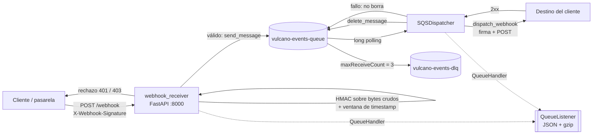
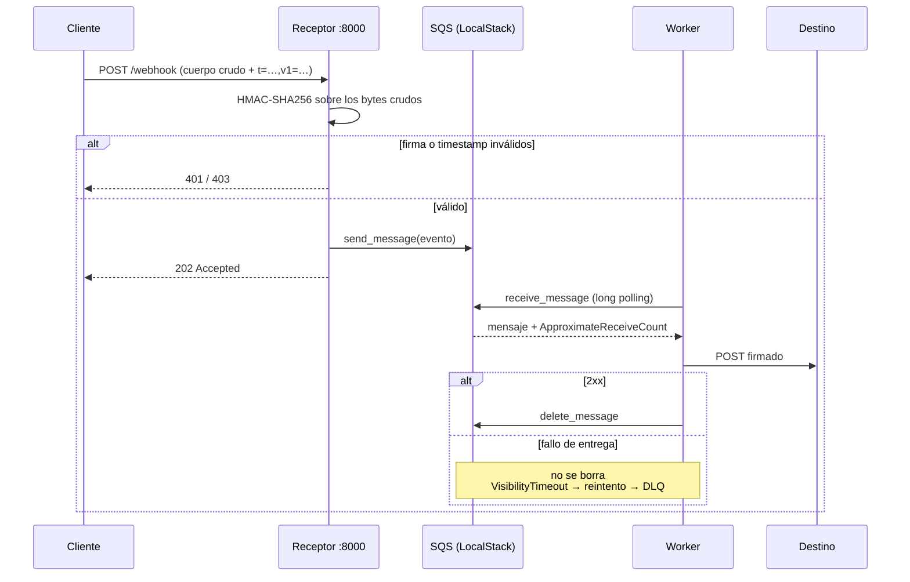

# Vulcano Telemetry — Proyecto Vulcano Pay

Motor de eventos asíncronos para Vulcano Pay: recepción de webhooks HTTP con validación
criptográfica HMAC-SHA256 sobre los bytes crudos, desacople mediante AWS SQS (emulado con
LocalStack) vía Boto3, despacho firmado hacia destinos de terceros y observabilidad con logs JSON
no bloqueantes y rotación comprimida.

Trabajo Práctico N.º 2 — Programación para Automatización II (UPATecO).

## Arquitectura



## Flujo de un evento



## Estructura

```
vulcano_engine/
├── src/
│   ├── vulcano_telemetry/
│   │   ├── __init__.py           # API pública del paquete (__all__)
│   │   ├── exceptions.py         # Excepciones semánticas del dominio
│   │   ├── sanitizer.py          # Validadores declarativos para argparse
│   │   ├── core_sqs.py           # Cliente Boto3 y mensajería SQS
│   │   ├── webhook_crypto.py     # Firma y verificación HMAC-SHA256
│   │   ├── webhook_receiver.py   # Servidor receptor de webhooks (FastAPI)
│   │   ├── logging_engine.py     # Formatter JSON, QueueHandler/Listener y rotación gzip
│   │   └── dispatcher.py         # Despachador de webhooks y worker SQS
│   └── app_operator.py           # Punto de entrada CLI (argparse + except*)
├── tests/                        # pytest: contrato, forense, caos e integración
├── scripts/bootstrap_localstack.py
├── docker-compose.yml
├── requirements.txt              # 5 paquetes obligatorios de ejecución
├── requirements-dev.txt          # pytest, ruff, httpx
└── pyproject.toml                # Empaquetado, pytest y ruff
```

## Puesta en marcha

```bash
python3 -m venv .venv
source .venv/bin/activate
pip install -r requirements.txt -r requirements-dev.txt
pip install -e . --no-deps                # habilita el comando `vulcano`

docker compose up -d                      # LocalStack en http://localhost:4566
python scripts/bootstrap_localstack.py    # crea la cola y su DLQ con el RedrivePolicy
```

El bootstrap es idempotente: se puede correr las veces que haga falta y reconcilia los atributos de
las colas en lugar de duplicarlas.

## Uso

Tres subcomandos. Todos comparten `-q/--queue`, `-w/--wait-time`, `--url`, `--secret`, `--timeout`
y `--log-file`; `--help` muestra la tabla de códigos de salida en `vulcano --help`.

```bash
# 1) Encolar un evento directamente en SQS
vulcano produce-sqs --payload '{"transaction_id":"tx_1","amount":350.0}' --event-topic payment.settled

# 2) Levantar el receptor de webhooks
vulcano start-receiver --port 8000

# 3) Consumir la cola y despachar (--max-lotes hace la corrida determinista)
vulcano start-dispatcher --url http://127.0.0.1:9000/webhook-destino --max-lotes 1
```

## Variables de entorno

Sólo se leen las variables de esta tabla; el resto de la configuración va por argumento de la CLI.
Las de LocalStack las consume el script de bootstrap, no la aplicación.

| Variable | Default | Quién la lee |
|---|---|---|
| `VULCANO_ENDPOINT_URL` | `http://localhost:4566` | bootstrap |
| `VULCANO_REGION` | `us-east-1` | bootstrap |
| `VULCANO_QUEUE_NAME` | `vulcano-events-queue` | bootstrap |
| `VULCANO_DLQ_NAME` | `vulcano-events-dlq` | bootstrap |
| `VULCANO_MAX_RECEIVE_COUNT` | `3` | bootstrap |
| `VULCANO_VISIBILITY_TIMEOUT` | `30` | bootstrap |
| `VULCANO_READY_TIMEOUT` | `60` | bootstrap (espera a que LocalStack responda) |
| `VULCANO_LOG_FILE` | `vulcano_events.log` | CLI |

Todo lo demás es argumento: `--queue`, `--wait-time`, `--url`, `--secret`, `--timeout`, `--host`,
`--port`, `--payload`, `--event-topic`, `--max-lotes` y `--log-file`. El tamaño de rotación (2 MB), la
cantidad de respaldos (3) y la ventana anti-replay (300 s) son constantes del engine y del
verificador.

## Códigos de respuesta del receptor

| Situación | Código | Excepción |
|---|---|---|
| Firma HMAC inválida o ausente | `401` | `WebhookSignatureError` |
| Timestamp fuera de la ventana anti-replay | `403` | `WebhookTimestampError` |
| JSON inservible después de validar la firma | `422` | — |
| LocalStack caído al encolar | `503` | `SQSConnectionError` |
| Webhook válido y encolado | `202` | — |

## Códigos de salida de la CLI

`0` correcto · `2` validación de argumentos · `3` firma o timestamp · `4` SQS · `5` entrega fallida ·
`130` interrupción por teclado.

## Observabilidad

Cada línea del registro es un objeto JSON con `timestamp` en ISO 8601 UTC del **instante del evento**,
`level`, `logger`, `message`, `process` y `thread_name`. Se agregan, sólo cuando la aplicación los
aporta, `trace_id`, `message_id`, `webhook_id`, `event_topic`, `signature`, `latency_ms`,
`retry_count` y `notes`. Las excepciones se registran como árbol (`exception`) más `traceback` en
texto; un `ExceptionGroup` conserva todos sus hijos y las notas de cada uno.

La escritura en disco ocurre únicamente en el hilo del `QueueListener`. El archivo activo rota a
2 MB, se conservan tres respaldos y cada respaldo se comprime a `.gz` de forma atómica.

## Pruebas

```bash
.venv/bin/python -m pytest -q                  # unitarias, sin Docker
VULCANO_IT=1 .venv/bin/python -m pytest -q     # incluye las de integración con LocalStack
```

| Archivo | Qué verifica |
|---|---|
| `tests/test_compliance.py` | criterios 1 y 2 por análisis del AST del repo completo |
| `tests/test_localstack_infra.py` | colas, `RedrivePolicy` y idempotencia del bootstrap |
| `tests/test_forensic_log.py` | contrato del log, árbol de excepciones, rotación gzip sin pérdida |
| `tests/test_webhook_dispatcher.py` | firma sobre bytes exactos, borrar sólo en 2xx, veneno aislado |
| `tests/test_cli.py` | subcomandos, códigos de salida y apagado del pipeline |
| `tests/test_chaos.py` | rechazos 401/403, replay y derivación real a la DLQ |

Las pruebas de integración se marcan con `@pytest.mark.integration` y se saltean solas si
`VULCANO_IT` no vale `1`: la suite unitaria corre sin Docker.

## Cumplimiento de los criterios de evaluación

| # | Criterio | Dónde | Cómo se verifica |
|---|---|---|---|
| 1 | Excepciones propias heredan de `Exception`; sin `except: pass` ni `BaseException` | `exceptions.py`, todo el paquete | `test_compliance.py` recorre el AST y falla si aparece un `except` desnudo, uno que capture `BaseException` o uno cuyo cuerpo sea sólo `pass` |
| 2 | PEP 765: sin `return`, `break` ni `continue` en `finally` | `app_operator.py` y el resto | `test_compliance.py` busca salidas abruptas alcanzables dentro de cada `finally`, sin cruzar definiciones de función |
| 3 | Boto3 con endpoint configurable a LocalStack | `core_sqs.py`, `dispatcher.py` | `get_sqs_client(endpoint_url)` y el bootstrap apuntando a `:4566` |
| 4 | HMAC sobre bytes crudos con `hmac.compare_digest()` | `webhook_crypto.py`, `dispatcher.py` | el receptor verifica antes de parsear; el emisor firma los mismos bytes que envía |
| 5 | Escritura de logs sólo por `QueueHandler` / `QueueListener` | `logging_engine.py` | ningún `FileHandler` cuelga del logger; la escritura ocurre en el hilo del listener |
| 6 | Marcas de tiempo en ISO 8601 UTC estricto | `AsyncJSONFormatter` | cada línea se parsea y se comprueba que el offset sea `+00:00` |

## Decisiones de diseño

**El reintento lo hace SQS, no el worker.** Ante una entrega fallida el mensaje no se borra: el
`VisibilityTimeout` lo devuelve a la cola y el `RedrivePolicy` lo deriva a la DLQ al superar
`maxReceiveCount`. Reintentar dentro del proceso escondería el fallo y no alimentaría el contador que
dispara la derivación.

**Un mensaje venenoso no arrastra el lote.** Un cuerpo que no es JSON se registra como venenoso y no
se borra, pero el resto del lote se procesa igual. Abortar la recepción completa haría que un solo
mensaje roto bloqueara a todos los que vinieron detrás y la DLQ nunca se llenaría.

**El registro se formatea en el hilo del listener.** El `prepare()` de `QueueHandler` de la stdlib
formatea el registro y anula `exc_info` antes de encolarlo, lo que borraría el árbol de la excepción
y devolvería el costo de formateo al hilo que loguea. El engine usa una subclase que sólo copia el
registro.

**Se firman y se envían los mismos bytes.** El cuerpo se serializa una sola vez y se pasa como `data`;
usar `json=` haría que la librería re-serialice y la firma del receptor dejaría de validar.

**La compresión de la rotación es atómica.** Se comprime a un temporal y se reemplaza con
`os.replace`, para que un corte no deje un `.gz` truncado en lugar del archivo bueno.

**El despachador vive en `dispatcher.py` y se re-exporta desde `app_operator.py`.** La lógica de
despacho no depende del módulo de entrada: así se prueba sin arrancar la CLI ni el pipeline de
logging. El símbolo `dispatch_webhook` sigue existiendo donde el enunciado lo nombra.

## Estado

Alcance completo de los roles 4 (observabilidad), 5 (despachador y CLI) y 6 (caos y forense). Los
módulos de los roles 1 a 3 —excepciones, sanitizadores, SQS, criptografía y receptor— se integran por
contrato de interfaces y se prueban desde acá.
