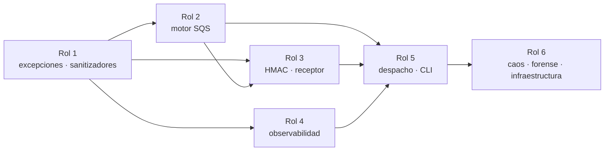
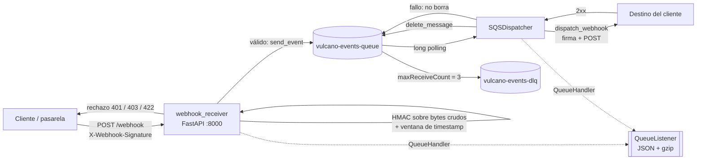
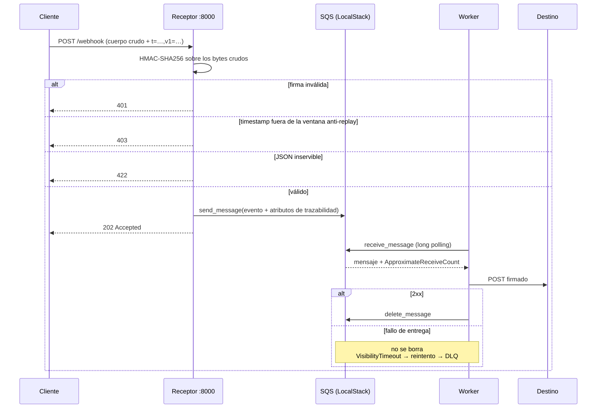

# Vulcano Telemetry — Proyecto Vulcano Pay

Motor de eventos asíncronos para Vulcano Pay: recepción de webhooks HTTP con validación
criptográfica HMAC-SHA256 sobre los bytes crudos, desacople mediante AWS SQS (emulado con
LocalStack) vía Boto3, despacho firmado hacia destinos de terceros y observabilidad con logs JSON
no bloqueantes y rotación comprimida.

## Trabajo Práctico N.º 2 — Programación para Automatización II (UPATecO).

## Integrantes del grupo

- **Gaita, Juan Pablo**
- **Gonza, Rodrigo Eduardo**

## Defensa del Proyecto

[Ver Video de la defensa del proyecto](https://drive.google.com/drive/folders/1dTO0F_5OOyZ8RcHXCUMeorA-dsuzPDrT?usp=sharing)

## Reparto de roles

El trabajo se dividió en seis roles. Cada módulo tiene un dueño, cada módulo tiene sus pruebas y
cada criterio de evaluación de la cátedra queda cubierto por un rol identificable. Las secciones de
[«Módulos»](#módulos-de-dominio) describen ese trabajo uno por uno.

| Rol | Responsabilidad | Módulos | Pruebas |
|---|---|---|---|
| 1 | Jerarquía de excepciones del dominio y sanitizadores declarativos de `argparse` | `exceptions.py`, `sanitizer.py` | `tests/test_integrante1.py` |
| 2 | Mensajería SQS con Boto3, atributos de trazabilidad y consumo tolerante a cuerpos corruptos | `core_sqs.py` | `tests/test_integrante2.py` |
| 3 | Firma y verificación HMAC-SHA256 y receptor HTTP sobre FastAPI | `webhook_crypto.py`, `webhook_receiver.py` | `tests/test_integrante3.py` |
| 4 | Observabilidad: log JSON no bloqueante con rotación comprimida a gzip | `logging_engine.py` | `tests/test_forensic_log.py` |
| 5 | Despacho firmado, worker SQS y CLI con subcomandos | `dispatcher.py`, `app_operator.py` | `tests/test_webhook_dispatcher.py`, `tests/test_cli.py` |
| 6 | Caos, inspección forense de los registros e infraestructura de la demo | `tests/test_chaos.py`, `tests/test_forensic_log.py`, `docker-compose.yml`, `scripts/bootstrap_localstack.py` | `tests/test_chaos.py`, `tests/test_localstack_infra.py` |
| Transversal | Fundaciones del repo y guardián de los criterios 1 y 2 de la cátedra | `pyproject.toml`, `requirements.txt`, `requirements-dev.txt`, `.gitignore`, `tests/test_compliance.py` | `tests/test_compliance.py` |



Flecha: el rol de la derecha usa el módulo del rol de la izquierda. La infraestructura y las
fundaciones son transversales y no tienen flechas: las consumen todos.

Los seis roles se integraron en un único pipeline. La reconciliación de las interfaces entre los
roles 1-3 y los roles 4-6 —más las correcciones de contrato del receptor y de los códigos de salida
de la CLI— está pinneada en `tests/test_contract_regressions.py`, para que ninguna de esas
correcciones se pierda en un refactor posterior.

## Condiciones de entrega

| Condición del enunciado | Cómo se cumple |
|---|---|
| `tests/` en plural | `tests/` con un `conftest.py` y diez archivos `test_*.py` |
| `README.md` como documentación técnica versionada, con diagramas Mermaid | este documento: arquitectura, secuencia y reparto de roles en Mermaid |
| `requirements.txt` con los 5 paquetes obligatorios | `boto3`, `botocore`, `fastapi`, `uvicorn`, `requests`; las dependencias de desarrollo viven en `requirements-dev.txt` |
| LocalStack emulando AWS en `http://localhost:4566` | `docker-compose.yml` + `scripts/bootstrap_localstack.py`, con la cola y su DLQ |

## Arquitectura



## Flujo de un evento



## Estructura

```
vulcano_engine/
├── src/
│   ├── vulcano_telemetry/
│   │   ├── __init__.py           # API pública del paquete (__all__)
│   │   ├── exceptions.py         # Excepciones semánticas del dominio (rol 1)
│   │   ├── sanitizer.py          # Validadores declarativos para argparse (rol 1)
│   │   ├── core_sqs.py           # Cliente Boto3 y mensajería SQS (rol 2)
│   │   ├── webhook_crypto.py     # Firma y verificación HMAC-SHA256 (rol 3)
│   │   ├── webhook_receiver.py   # Servidor receptor de webhooks (FastAPI, rol 3)
│   │   ├── logging_engine.py     # Formatter JSON, QueueHandler/Listener y rotación gzip (rol 4)
│   │   └── dispatcher.py         # Despachador de webhooks y worker SQS (rol 5)
│   └── app_operator.py           # Punto de entrada CLI (argparse + except*, rol 5)
├── tests/                        # pytest: contrato, forense, caos, integración y roles 1-6
├── scripts/bootstrap_localstack.py   # Colas, DLQ y RedrivePolicy (rol 6)
├── docker-compose.yml            # LocalStack 4 con sólo SQS (rol 6)
├── requirements.txt              # 5 paquetes obligatorios de ejecución
├── requirements-dev.txt          # pytest, ruff, httpx
└── pyproject.toml                # Empaquetado, pytest y ruff
```

## Módulos de dominio

### Rol 1 — excepciones y sanitización

`exceptions.py` define la jerarquía del dominio: todo hereda de `VulcanoError`, que hereda de
`Exception` (el criterio 1 prohíbe `BaseException`). Las subclases son `SQSConnectionError`,
`QueueTimeoutError`, `CorruptedMessageError`, `WebhookSignatureError`, `WebhookTimestampError` y
`WebhookDeliveryError`. `QueueTimeoutError` es la que distingue "la cola quedó vacía" de "SQS
falló": sin ella, una espera agotada se confundiría con un error de conexión.

`sanitizer.py` expone cuatro validadores que la CLI usa como `type=` de `argparse`, así el rechazo
ocurre antes de tocar la red y sale con código 2:

| Validador | Qué exige |
|---|---|
| `parse_queue_name` | Patrón completo `vulcano-[a-z0-9-]+-queue` (`re.fullmatch`: un `\n` final no pasa) |
| `parse_wait_time` | Entero entre 1 y 20 segundos (rango de `WaitTimeSeconds`) |
| `parse_webhook_url` | Esquema `http`/`https`, host válido y puerto válido si viene |
| `parse_secret_key` | Clave HMAC de al menos 16 caracteres |

### Rol 2 — motor SQS

`core_sqs.py` centraliza la mensajería con Boto3 apuntando a un endpoint configurable
(`get_sqs_client(endpoint_url)`), y traduce todo `ClientError`/`BotoCoreError` a
`SQSConnectionError` con `add_note()` para la URL y la operación.

| Función | Comportamiento |
|---|---|
| `send_event(client, queue_url, event_data, trace_id=None, event_topic="payment.event", webhook_id=None)` | Serializa una sola vez y publica con los atributos de trazabilidad |
| `produce_event(client, queue_url, event_data)` | Compatibilidad con la interfaz original; delega en `send_event` |
| `receive_events(...)` | Long polling; levanta `CorruptedMessageError` si un cuerpo no es JSON |
| `receive_events_safe(...)` | Igual, pero devuelve `{"valid": [...], "corrupted": [...]}` sin abortar el lote |
| `consume_events(...)` | Contrato estable de consumo: lista de mensajes con `approx_receive_count` y la marca `corrupt` |
| `delete_message(client, queue_url, receipt_handle)` | Borra explícitamente; señal de "entregado" |

Los eventos publicados con `send_event` llevan estos atributos de mensaje:

| Atributo | Tipo | Origen |
|---|---|---|
| `TraceId` | `String` | parámetro o `uuid4()`; es la columna vertebral de la trazabilidad |
| `EventTopic` | `String` | parámetro (por defecto `payment.event`) |
| `Timestamp` | `String` | ISO 8601 UTC del instante del evento |
| `WebhookId` | `String` | opcional: identidad del webhook, cuando el emisor la conoce |

Un cuerpo corrupto nunca se borra y nunca cancela al resto del lote: queda aislado para que el
`VisibilityTimeout` lo devuelva a la cola y el `RedrivePolicy` lo derive a la DLQ.

### Rol 3 — seguridad HMAC y receptor

`webhook_crypto.py` firma `timestamp + "." + payload_bytes` con HMAC-SHA256 y compara con
`hmac.compare_digest()`. `build_signature_header()` es el único dueño del formato de la cabecera, así
emisor y receptor no pueden divergir:

```
X-Webhook-Signature: t=<timestamp>,v1=<hmac-hexadecimal>
```

`verify_signature()` valida primero la forma de la cabecera, después la ventana anti-replay
(±300 s) y por último la firma. Una firma malformada o ausente es `WebhookSignatureError`; un
timestamp viejo o futuro es `WebhookTimestampError`.

`webhook_receiver.py` expone `POST /webhook` con FastAPI. La secuencia es: leer los **bytes crudos**,
verificar firma y timestamp, parsear el JSON, publicar en SQS y responder `202 Accepted`. El cliente
de SQS y la URL de la cola se resuelven en el `lifespan` (una sola vez) con `get_queue_url`, y la
clave HMAC se toma de `VULCANO_WEBHOOK_SECRET`: no hay secretos en el código.

### Rol 4 — observabilidad y logging estructurado

`logging_engine.py` monta el pipeline en tres piezas: **`UnformattedQueueHandler`** sólo encola el
`LogRecord` en una cola en memoria, **`QueueListener`** corre en su propio hilo y es quien escribe, y
un **`RotatingFileHandler`** de 2 MB con tres respaldos comprime cada respaldo a `.gz`. El hilo que
loguea nunca toca el disco: ese es el criterio 5 de la evaluación.

| Símbolo | Qué hace |
|---|---|
| `setup_vulcano_logging(log_file="vulcano_events.log", *, level, max_bytes, backup_count, logger_name)` | Arma el pipeline y devuelve la `LoggingSession` que lo posee; idempotente por logger (detiene la sesión anterior y limpia handlers, así dos llamadas no duplican líneas) |
| `LoggingSession.stop()` | Detiene el listener y cierra el archivo. `QueueListener.stop()` encola un centinela y hace `join()` sobre una cola FIFO, así que todo lo pendiente se escribe antes de terminar; se puede llamar dos veces |
| `shutdown_vulcano_logging()` | Detiene todas las sesiones activas; es lo que corre el `finally` de la CLI |
| `AsyncJSONFormatter` | Serializa el registro a una línea JSON con la marca de tiempo del evento |
| `serialize_exception(exc, depth=0)` | Traduce una excepción a un árbol JSON: tipo, mensaje, `notes`, `exceptions` de un `ExceptionGroup` y la cadena `cause`/`context`; la recursión está acotada (`MAX_EXCEPTION_DEPTH`) |
| `rotated_name` / `rotate_to_gzip` | Callbacks `namer` y `rotator` del handler: comprimen a un `.tmp` y reemplazan con `os.replace`, así un corte de energía no deja un `.gz` truncado en el lugar del archivo bueno |

El contrato del registro —el que valida `tests/test_forensic_log.py`— es este:

| Grupo | Campos |
|---|---|
| Fijos, siempre presentes | `timestamp` (ISO 8601 UTC, offset `+00:00`), `level`, `logger`, `message`, `process`, `thread_name` |
| Opcionales, sólo si llegan por `extra` | `trace_id`, `message_id`, `webhook_id`, `event_topic`, `signature`, `latency_ms`, `retry_count`, `notes` |
| De excepción | `exception` (árbol recursivo del `ExceptionGroup` con sus notas) y `traceback` en texto |

El formatter nunca inventa un campo opcional: si la aplicación no lo aportó, no aparece. Una línea
real de un fallo de entrega se ve así:

```json
{"timestamp": "2026-11-01T23:42:10.512000+00:00", "level": "ERROR", "logger": "vulcano_engine",
 "message": "Entrega fallida.", "process": 4242, "thread_name": "MainThread",
 "trace_id": "0f3c…", "message_id": "8b1e…", "retry_count": 2, "latency_ms": 12.4,
 "exception": {"type": "WebhookDeliveryError", "message": "El destino … respondió HTTP 500.",
               "notes": ["status_code=500"], "exceptions": []},
 "traceback": "Traceback (most recent call last): …"}
```

### Rol 5 — despacho firmado y CLI

`dispatcher.py` entrega el webhook y `app_operator.py` es la CLI que lo opera todo.

**Despacho.** `serialize_body(payload)` produce los bytes exactos (`json.dumps` con separadores
compactos) que se firman y se envían; `dispatch_webhook(target_url, secret, payload, *, timeout=5.0,
session=None)` firma con `build_signature_header` y hace el `POST` con `data=`, no con `json=`, para
que `requests` no re-serialice y rompa la firma. Devuelve un `DispatchResult(status_code, latency_ms,
timestamp)`; cualquier cosa que no sea 2xx —4xx, 5xx, timeout, conexión rechazada— es
`WebhookDeliveryError` con notas de contexto. `build_signature_header` de este módulo delega en el
del rol 3: el formato de la cabecera tiene un solo dueño.

**Worker.** `SQSDispatcher` consume con long polling (`wait_time=10`, `visibility_timeout=30`,
`max_messages=5`) y pide `AttributeNames=["ApproximateReceiveCount"]`. Su regla de oro: el mensaje se
borra **sólo** cuando el destino confirmó con 2xx. `process(message) -> bool`, `process_batch()`,
`run(iterations=None)` y `stop()` —que atiende el corte entre lotes, nunca a mitad de uno— más los
contadores `delivered`/`failed`. No hay reintentos en proceso: el reintento lo hace SQS.

**CLI.** Tres subcomandos (`produce-sqs`, `start-receiver`, `start-dispatcher`) con los cuatro
sanitizadores del rol 1 como `type=`. `VulcanoParser.exit()` convierte el `SystemExit` de `argparse`
en `ParserExit`, así que `main()` devuelve un `int` y ningún `except` captura `BaseException`.
`start-receiver` resuelve la cola **antes** de cederle el proceso a uvicorn y exporta el nombre
resuelto a `VULCANO_QUEUE_NAME`, para que `-q/--queue` no quede ignorado y para que una cola
inexistente salga con código 4 en lugar de morir con un traceback de uvicorn. La URL de la cola
siempre se pide con `get_queue_url`: nunca se concatena a mano.

Los cuatro `except*` de `main()` traducen los grupos del dominio a códigos de salida, y el `finally`
apaga el pipeline sin `return`, `break` ni `continue` (criterio 2). La interrupción por teclado no se
captura con `except*` —PEP 654 no permite mezclar `except` y `except*` en la misma sentencia—: sale
de un context manager cuyo `__exit__` recibe la excepción y devuelve el código 130.

El símbolo `dispatch_webhook` se re-exporta desde `app_operator.py`, que es donde el enunciado lo
ubica; vivir en `dispatcher.py` permite probarlo sin arrancar la CLI ni el pipeline de logging.

### Rol 6 — caos, forense e infraestructura

Dos suites con propósitos distintos y la infraestructura que hace correr la demo.

**Caos (`tests/test_chaos.py`).** Ataca el receptor real para comprobar que las defensas existen:

| Caso | Qué verifica |
|---|---|
| Firma alterada | un solo carácter distinto en el hex ya no autentica |
| Secreto incorrecto | una cabecera bien formada firmada con otra clave se rechaza |
| Timestamp de hace una hora | replay fuera de la ventana anti-replay |
| Webhook válido | `202 Accepted` y el mensaje nuevo en la cola, identificado por su marcador |
| Mensaje venenoso | el cuerpo que no es JSON no se borra y el `RedrivePolicy` lo deriva a la DLQ |

Los tres casos de rechazo corren sin Docker, con `TestClient` y con un fixture (`enqueue_forbidden`)
que falla si el rechazo llegó a publicar algo en SQS: el caos también verifica que no haya efectos
laterales. Los dos últimos son de integración y hablan con LocalStack real. Los códigos esperados son
`{401, 403}` porque el enunciado (S11) admite ambos: el caso verifica el rechazo, no cuál de los dos
eligió el receptor.

La prueba del veneno usa colas propias (`vulcano-test-queue` / `vulcano-test-dlq`) con
`maxReceiveCount=1` y `VisibilityTimeout=0`, y las borra al terminar: la derivación a la DLQ se ve en
menos de un segundo y la cola de la demo no se ensucia.

**Forense (`tests/test_forensic_log.py`).** Inspecciona los archivos que el sistema produce de verdad
—no el estado interno del logger—: abre los `.log.gz`, descomprime sin pérdida, parsea cada línea y
comprueba `TraceId`, `MessageId`, `X-Webhook-Signature`, el árbol de un `ExceptionGroup`, la rotación
y que la escritura ocurra en el hilo del listener. El archivo lo comparten el rol 4 (dueño del
módulo) y el rol 6 (dueño de la auditoría forense).

**Infraestructura.** `docker-compose.yml` levanta LocalStack 4 con sólo SQS y un volumen persistente.
`scripts/bootstrap_localstack.py` es idempotente: crea la DLQ y la cola principal con su
`RedrivePolicy` (`maxReceiveCount=3`, `VisibilityTimeout=30`) o reconcilia los atributos si ya
existen, y sale con `0` si todo quedó configurado o `4` si LocalStack no responde.
`tests/test_localstack_infra.py` verifica colas, `RedrivePolicy`, idempotencia y el fallo con código 4
sin LocalStack.

## Puesta en marcha

```bash
python3 -m venv .venv
source .venv/bin/activate
pip install -r requirements.txt -r requirements-dev.txt
pip install -e . --no-deps                # habilita el comando `vulcano`

docker compose up -d                      # LocalStack en http://localhost:4566
python scripts/bootstrap_localstack.py    # crea la cola y su DLQ con el RedrivePolicy
```

El bootstrap es idempotente: se puede correr las veces que haga falta y reconcilia los atributos de
las colas en lugar de duplicarlas. En Windows, los mismos comandos se ejecutan en PowerShell con
`.\.venv\Scripts\Activate.ps1` y `python .\scripts\bootstrap_localstack.py`; no hace falta ninguna
variante del código.

## Uso

Tres subcomandos. Todos comparten `-q/--queue`, `-w/--wait-time`, `--url`, `--secret`, `--timeout`
y `--log-file`; `vulcano --help` muestra la tabla de códigos de salida.

```bash
# 1) Encolar un evento directamente en SQS
vulcano produce-sqs --payload '{"transaction_id":"tx_1","amount":350.0}' --event-topic payment.settled

# 2) Levantar el receptor de webhooks (necesita VULCANO_WEBHOOK_SECRET y las colas creadas)
vulcano start-receiver --port 8000

# 3) Consumir la cola y despachar (--max-lotes hace la corrida determinista)
vulcano start-dispatcher --url http://127.0.0.1:9000/webhook-destino --max-lotes 1
```

La CLI no imprime el resultado en pantalla: informa por el código de salida y por el registro JSON.
Para ver qué hizo una corrida, mirá las últimas líneas del archivo de log (`tail -2
vulcano_events.log`), que es donde queda cada entrega con su `trace_id` y su `latency_ms`.

### Prueba de punta a punta

El receptor sólo acepta webhooks firmados, así que para probar el camino completo hacen falta el
secreto, un emisor que firme y un destino que confirme con 2xx. Los comandos de abajo están
verificados contra el LocalStack de este repo.

**Terminal 1 — el secreto y el receptor.** Sin `VULCANO_WEBHOOK_SECRET` el receptor responde `503` a
todo: no puede autenticar a nadie.

```bash
export VULCANO_WEBHOOK_SECRET="clave-de-demostracion-suficientemente-larga"
vulcano --help                 # subcomandos y tabla de códigos de salida
vulcano start-receiver --port 8000
```

**Terminal 2 — un destino local que confirma con 2xx.** El worker sólo borra el mensaje cuando el
destino responde 2xx; cualquier otra cosa lo deja en la cola y alimenta el `RedrivePolicy`.

```bash
python3 -c "
from http.server import BaseHTTPRequestHandler, HTTPServer

class Handler(BaseHTTPRequestHandler):
    def do_POST(self):
        self.send_response(200)
        self.end_headers()
        print('POST recibido, respondido 200')

HTTPServer(('127.0.0.1', 9000), Handler).handle_request()
"
```

**Terminal 3 — firmar y enviar un webhook válido.** El cuerpo se serializa una sola vez porque la
firma se calcula sobre esos bytes exactos.

```bash
python3 - <<'PY'
import json, os, requests
from vulcano_telemetry.webhook_crypto import build_signature_header

secret = os.environ["VULCANO_WEBHOOK_SECRET"]
body = json.dumps({"transaction_id": "tx_demo", "amount": 350.0}, separators=(",", ":")).encode()
_, header = build_signature_header(secret, body)
response = requests.post(
    "http://127.0.0.1:8000/webhook",
    data=body,
    headers={"Content-Type": "application/json", "X-Webhook-Signature": header},
    timeout=5,
)
print(response.status_code, response.text)   # 202 {"status":"accepted","message_id":"..."}
PY
```

**Terminal 1 — una pasada del worker** contra el destino de la terminal 2.

```bash
vulcano start-dispatcher --url http://127.0.0.1:9000/webhook-destino \
  --secret "$VULCANO_WEBHOOK_SECRET" --max-lotes 1
tail -2 vulcano_events.log
```

**Mirar la cola y la DLQ sin la CLI de AWS.** Las credenciales simuladas son las mismas que usa el
bootstrap.

```bash
python3 - <<'PY'
import boto3

sqs = boto3.client("sqs", endpoint_url="http://localhost:4566", region_name="us-east-1",
                   aws_access_key_id="test", aws_secret_access_key="test")
for name in ("vulcano-events-queue", "vulcano-events-dlq"):
    url = sqs.get_queue_url(QueueName=name)["QueueUrl"]
    attributes = sqs.get_queue_attributes(QueueUrl=url, AttributeNames=["ApproximateNumberOfMessages"])
    print(name, attributes["Attributes"]["ApproximateNumberOfMessages"])
PY
```

**Comprobar un código de error.** Una cola inexistente es un error de SQS, no de validación de
argumentos:

```bash
vulcano produce-sqs -q vulcano-no-existe-queue --payload '{"a":1}'
echo "exit: $?"                # 4 — error de SQS
```

Lo más rápido para ver el sistema entero sin armar el escenario a mano es la suite de integración:

```bash
VULCANO_IT=1 .venv/bin/python -m pytest -q
```

## Variables de entorno

Sólo se leen las variables de esta tabla; el resto de la configuración va por argumento de la CLI.

| Variable | Default | Quién la lee |
|---|---|---|
| `VULCANO_WEBHOOK_SECRET` | — (obligatoria, mínimo 16 caracteres) | receptor |
| `VULCANO_ENDPOINT_URL` | `http://localhost:4566` | bootstrap y receptor |
| `VULCANO_REGION` | `us-east-1` | bootstrap |
| `VULCANO_QUEUE_NAME` | `vulcano-events-queue` | bootstrap, receptor (y `start-receiver` lo exporta con el nombre resuelto) |
| `VULCANO_DLQ_NAME` | `vulcano-events-dlq` | bootstrap |
| `VULCANO_MAX_RECEIVE_COUNT` | `3` | bootstrap |
| `VULCANO_VISIBILITY_TIMEOUT` | `30` | bootstrap |
| `VULCANO_READY_TIMEOUT` | `60` | bootstrap (espera a que LocalStack responda) |
| `VULCANO_LOG_FILE` | `vulcano_events.log` | CLI |
| `VULCANO_IT` | — | suite de pruebas (`1` habilita las de integración) |

Todo lo demás es argumento: `--queue`, `--wait-time`, `--url`, `--secret`, `--timeout`, `--host`,
`--port`, `--payload`, `--event-topic`, `--max-lotes` y `--log-file`. El tamaño de rotación (2 MB), la
cantidad de respaldos (3) y la ventana anti-replay (300 s) son constantes del engine y del
verificador.

Sin `VULCANO_WEBHOOK_SECRET` el receptor arranca pero responde `503` a todo: no puede autenticar a
nadie.

## Códigos de respuesta del receptor

| Situación | Código | Excepción |
|---|---|---|
| Firma HMAC inválida o ausente | `401` | `WebhookSignatureError` |
| Timestamp fuera de la ventana anti-replay | `403` | `WebhookTimestampError` |
| JSON inservible después de validar la firma | `422` | — |
| Secreto sin configurar (o demasiado corto) | `503` | `HTTPException` |
| LocalStack caído o cola irresoluble al encolar | `503` | `SQSConnectionError` |
| Webhook válido y encolado | `202` | — |

## Códigos de salida de la CLI

`0` correcto · `2` validación de argumentos · `3` firma o timestamp · `4` SQS · `5` entrega fallida ·
`130` interrupción por teclado.

El `4` cubre los tres momentos en que SQS puede fallar: una cola que no se puede resolver —también
en `start-receiver`, donde se resuelve **antes** de entregar el proceso a uvicorn, para que una cola
inexistente no termine en un `SystemExit` de uvicorn—, un error al publicar con `produce-sqs` y un
error al recibir o borrar con `start-dispatcher`.

## Pruebas

```bash
.venv/bin/python -m pytest -q                  # unitarias, sin Docker
VULCANO_IT=1 .venv/bin/python -m pytest -q     # incluye las de integración con LocalStack
```

| Archivo | Qué verifica | Rol |
|---|---|---|
| `tests/test_compliance.py` | criterios 1 y 2 por análisis del AST del repo completo | transversal |
| `tests/test_integrante1.py` | jerarquía de excepciones y los cuatro sanitizadores | 1 |
| `tests/test_integrante2.py` | publicación, recepción, mensaje corrupto, borrado y atributos de trazabilidad en SQS (cliente simulado) | 2 |
| `tests/test_integrante3.py` | firma/verificación HMAC y el receptor por HTTP (`TestClient`) | 3 |
| `tests/test_forensic_log.py` | contrato del log, árbol de excepciones, rotación gzip sin pérdida y escritura en el hilo del listener | 4 y 6 |
| `tests/test_webhook_dispatcher.py` | firma sobre bytes exactos, borrar sólo en 2xx, veneno aislado | 5 |
| `tests/test_cli.py` | subcomandos, códigos de salida y apagado del pipeline | 5 |
| `tests/test_contract_regressions.py` | contratos que la reconciliación dejó fijados: 503 sin secreto, precedencia del topic, `VULCANO_ENDPOINT_URL`, re-export de `QueueTimeoutError`, camino a `4` en `start-receiver`, export del nombre de cola y precedencia de `-q` sobre el entorno | 3 y 5 |
| `tests/test_chaos.py` | rechazos por firma, secreto y replay; webhook válido aceptado; derivación real a la DLQ | 6 |
| `tests/test_localstack_infra.py` | colas, `RedrivePolicy` e idempotencia del bootstrap | 6 |

Las pruebas de integración se marcan con `@pytest.mark.integration` y se saltean solas si
`VULCANO_IT` no vale `1`: la suite unitaria corre sin Docker. Las de los roles 1-3 usan dobles, así
que tampoco necesitan LocalStack.

## Cumplimiento de los criterios de evaluación

| # | Criterio | Rol | Dónde | Cómo se verifica |
|---|---|---|---|---|
| 1 | Excepciones propias heredan de `Exception`; sin `except: pass` ni `BaseException` | 1 | `exceptions.py`, todo el paquete | `test_compliance.py` recorre el AST y falla si aparece un `except` desnudo, uno que capture `BaseException` o uno cuyo cuerpo sea sólo `pass` |
| 2 | PEP 765: sin `return`, `break` ni `continue` en `finally` | 5 | `app_operator.py` y el resto | `test_compliance.py` busca salidas abruptas alcanzables dentro de cada `finally`, sin cruzar definiciones de función |
| 3 | Boto3 con endpoint configurable a LocalStack | 2 y 6 | `core_sqs.py`, `dispatcher.py`, bootstrap | `get_sqs_client(endpoint_url)`, el bootstrap apuntando a `:4566` y las pruebas de integración contra LocalStack real |
| 4 | HMAC sobre bytes crudos con `hmac.compare_digest()` | 3 y 5 | `webhook_crypto.py`, `dispatcher.py` | el receptor verifica antes de parsear; el emisor firma los mismos bytes que envía |
| 5 | Escritura de logs sólo por `QueueHandler` / `QueueListener` | 4 | `logging_engine.py` | ningún `FileHandler` cuelga del logger; la escritura ocurre en el hilo del listener |
| 6 | Marcas de tiempo en ISO 8601 UTC estricto | 4 | `AsyncJSONFormatter` | cada línea se parsea y se comprueba que el offset sea `+00:00` |

## Decisiones de diseño

**El reintento lo hace SQS, no el worker.** Ante una entrega fallida el mensaje no se borra: el
`VisibilityTimeout` lo devuelve a la cola y el `RedrivePolicy` lo deriva a la DLQ al superar
`maxReceiveCount`. Reintentar dentro del proceso escondería el fallo y no alimentaría el contador que
dispara la derivación.

**Un mensaje venenoso no arrastra el lote.** Un cuerpo que no es JSON se registra como venenoso y no
se borra, pero el resto del lote se procesa igual. Abortar la recepción completa haría que un solo
mensaje roto bloqueara a todos los que vinieron detrás y la DLQ nunca se llenaría. El módulo expone
las dos variantes para que el consumidor elija: `receive_events` aborta y `receive_events_safe`
aísla. El worker no usa ninguna de las dos: recibe con `client.receive_message` y aísla el cuerpo
corrupto mensaje por mensaje, porque necesita borrar de a uno y `consume_events` todavía no expone
el borrado.

**El registro se formatea en el hilo del listener.** El `prepare()` de `QueueHandler` de la stdlib
formatea el registro y anula `exc_info` antes de encolarlo, lo que borraría el árbol de la excepción
y devolvería el costo de formateo al hilo que loguea. El engine usa una subclase que sólo copia el
registro.

**El `timestamp` es el del evento, no el de la escritura.** Se toma `record.created` y no el reloj
del formatter: como la escritura ocurre después y en otro hilo, usar el reloj de escritura
desordenaría la línea temporal que después se audita.

**La compresión de los respaldos es atómica.** Se comprime a un `.tmp` y se reemplaza con
`os.replace`: un corte de energía no puede dejar un `.gz` truncado ocupando el lugar del archivo
bueno.

**El formato de la cabecera tiene un solo dueño.** `build_signature_header()` del rol 3 compone
`t=…,v1=…` y `verify_signature()` lo interpreta; el despachador delega en él en lugar de
reimplementarlo, así el round-trip emisor/receptor está garantizado por construcción y no por
convención.

**La clave HMAC llega por entorno.** `VULCANO_WEBHOOK_SECRET` es obligatoria y se valida su longitud
mínima al verificar; el repositorio no lleva secretos versionados.
