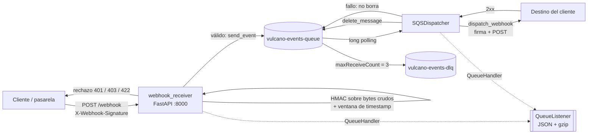
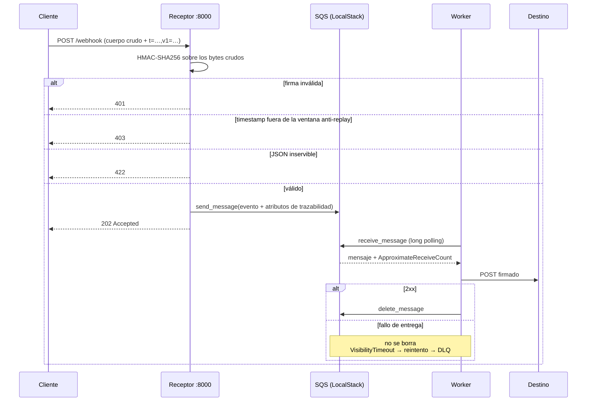

# Vulcano Telemetry — Proyecto Vulcano Pay

Motor de eventos asíncronos para Vulcano Pay: recepción de webhooks HTTP con validación
criptográfica HMAC-SHA256 sobre los bytes crudos, desacople mediante AWS SQS (emulado con
LocalStack) vía Boto3, despacho firmado hacia destinos de terceros y observabilidad con logs JSON
no bloqueantes y rotación comprimida.

Trabajo Práctico N.º 2 — Programación para Automatización II (UPATecO).

## Arquitectura



## Flujo de un evento



## Estructura

```
vulcano_engine/
├── src/
│   ├── vulcano_telemetry/
│   │   ├── __init__.py           # API pública del paquete (__all__)
│   │   ├── exceptions.py         # Excepciones semánticas del dominio (rol 1)
│   │   ├── sanitizer.py          # Validadores declarativos para argparse (rol 1)
│   │   ├── core_sqs.py           # Cliente Boto3 y mensajería SQS (rol 2)
│   │   ├── webhook_crypto.py     # Firma y verificación HMAC-SHA256 (rol 3)
│   │   ├── webhook_receiver.py   # Servidor receptor de webhooks (FastAPI, rol 3)
│   │   ├── logging_engine.py     # Formatter JSON, QueueHandler/Listener y rotación gzip (rol 4)
│   │   └── dispatcher.py         # Despachador de webhooks y worker SQS (rol 5)
│   └── app_operator.py           # Punto de entrada CLI (argparse + except*, rol 5)
├── tests/                        # pytest: contrato, forense, caos, integración y roles 1-3
├── scripts/bootstrap_localstack.py
├── docker-compose.yml
├── requirements.txt              # 5 paquetes obligatorios de ejecución
├── requirements-dev.txt          # pytest, ruff, httpx
└── pyproject.toml                # Empaquetado, pytest y ruff
```

## Módulos de dominio

### Rol 1 — excepciones y sanitización

`exceptions.py` define la jerarquía del dominio: todo hereda de `VulcanoError`, que hereda de
`Exception` (el criterio 1 prohíbe `BaseException`). Las subclases son `SQSConnectionError`,
`QueueTimeoutError`, `CorruptedMessageError`, `WebhookSignatureError`, `WebhookTimestampError` y
`WebhookDeliveryError`. `QueueTimeoutError` es la que distingue "la cola quedó vacía" de "SQS
falló": sin ella, una espera agotada se confundiría con un error de conexión.

`sanitizer.py` expone cuatro validadores que la CLI usa como `type=` de `argparse`, así el rechazo
ocurre antes de tocar la red y sale con código 2:

| Validador | Qué exige |
|---|---|
| `parse_queue_name` | Patrón completo `vulcano-[a-z0-9-]+-queue` (`re.fullmatch`: un `\n` final no pasa) |
| `parse_wait_time` | Entero entre 1 y 20 segundos (rango de `WaitTimeSeconds`) |
| `parse_webhook_url` | Esquema `http`/`https`, host válido y puerto válido si viene |
| `parse_secret_key` | Clave HMAC de al menos 16 caracteres |

### Rol 2 — motor SQS

`core_sqs.py` centraliza la mensajería con Boto3 apuntando a un endpoint configurable
(`get_sqs_client(endpoint_url)`), y traduce todo `ClientError`/`BotoCoreError` a
`SQSConnectionError` con `add_note()` para la URL y la operación.

| Función | Comportamiento |
|---|---|
| `send_event(client, queue_url, event_data, trace_id=None, event_topic="payment.event", webhook_id=None)` | Serializa una sola vez y publica con los atributos de trazabilidad |
| `produce_event(client, queue_url, event_data)` | Compatibilidad con la interfaz original; delega en `send_event` |
| `receive_events(...)` | Long polling; levanta `CorruptedMessageError` si un cuerpo no es JSON |
| `receive_events_safe(...)` | Igual, pero devuelve `{"valid": [...], "corrupted": [...]}` sin abortar el lote |
| `consume_events(...)` | Contrato estable de consumo: lista de mensajes con `approx_receive_count` y la marca `corrupt` |
| `delete_message(client, queue_url, receipt_handle)` | Borra explícitamente; señal de "entregado" |

Los eventos publicados con `send_event` llevan estos atributos de mensaje:

| Atributo | Tipo | Origen |
|---|---|---|
| `TraceId` | `String` | parámetro o `uuid4()`; es la columna vertebral de la trazabilidad |
| `EventTopic` | `String` | parámetro (por defecto `payment.event`) |
| `Timestamp` | `String` | ISO 8601 UTC del instante del evento |
| `WebhookId` | `String` | opcional: identidad del webhook, cuando el emisor la conoce |

Un cuerpo corrupto nunca se borra y nunca cancela al resto del lote: queda aislado para que el
`VisibilityTimeout` lo devuelva a la cola y el `RedrivePolicy` lo derive a la DLQ.

### Rol 3 — seguridad HMAC y receptor

`webhook_crypto.py` firma `timestamp + "." + payload_bytes` con HMAC-SHA256 y compara con
`hmac.compare_digest()`. `build_signature_header()` es el único dueño del formato de la cabecera, así
emisor y receptor no pueden divergir:

```
X-Webhook-Signature: t=<timestamp>,v1=<hmac-hexadecimal>
```

`verify_signature()` valida primero la forma de la cabecera, después la ventana anti-replay
(±300 s) y por último la firma. Una firma malformada o ausente es `WebhookSignatureError`; un
timestamp viejo o futuro es `WebhookTimestampError`.

`webhook_receiver.py` expone `POST /webhook` con FastAPI. La secuencia es: leer los **bytes crudos**,
verificar firma y timestamp, parsear el JSON, publicar en SQS y responder `202 Accepted`. El cliente
de SQS y la URL de la cola se resuelven en el `lifespan` (una sola vez) con `get_queue_url`, y la
clave HMAC se toma de `VULCANO_WEBHOOK_SECRET`: no hay secretos en el código.

## Puesta en marcha

```bash
python3 -m venv .venv
source .venv/bin/activate
pip install -r requirements.txt -r requirements-dev.txt
pip install -e . --no-deps                # habilita el comando `vulcano`

docker compose up -d                      # LocalStack en http://localhost:4566
python scripts/bootstrap_localstack.py    # crea la cola y su DLQ con el RedrivePolicy
```

El bootstrap es idempotente: se puede correr las veces que haga falta y reconcilia los atributos de
las colas en lugar de duplicarlas. En Windows, los mismos comandos se ejecutan en PowerShell con
`.\.venv\Scripts\Activate.ps1` y `python .\scripts\bootstrap_localstack.py`; no hace falta ninguna
variante del código.

## Uso

Tres subcomandos. Todos comparten `-q/--queue`, `-w/--wait-time`, `--url`, `--secret`, `--timeout`
y `--log-file`; `vulcano --help` muestra la tabla de códigos de salida.

```bash
# 1) Encolar un evento directamente en SQS
vulcano produce-sqs --payload '{"transaction_id":"tx_1","amount":350.0}' --event-topic payment.settled

# 2) Levantar el receptor de webhooks (necesita VULCANO_WEBHOOK_SECRET y las colas creadas)
vulcano start-receiver --port 8000

# 3) Consumir la cola y despachar (--max-lotes hace la corrida determinista)
vulcano start-dispatcher --url http://127.0.0.1:9000/webhook-destino --max-lotes 1
```

## Variables de entorno

Sólo se leen las variables de esta tabla; el resto de la configuración va por argumento de la CLI.

| Variable | Default | Quién la lee |
|---|---|---|
| `VULCANO_WEBHOOK_SECRET` | — (obligatoria, mínimo 16 caracteres) | receptor |
| `VULCANO_ENDPOINT_URL` | `http://localhost:4566` | bootstrap y receptor |
| `VULCANO_REGION` | `us-east-1` | bootstrap |
| `VULCANO_QUEUE_NAME` | `vulcano-events-queue` | bootstrap, receptor y valor por defecto de `--queue` en la CLI |
| `VULCANO_DLQ_NAME` | `vulcano-events-dlq` | bootstrap |
| `VULCANO_MAX_RECEIVE_COUNT` | `3` | bootstrap |
| `VULCANO_VISIBILITY_TIMEOUT` | `30` | bootstrap |
| `VULCANO_READY_TIMEOUT` | `60` | bootstrap (espera a que LocalStack responda) |
| `VULCANO_LOG_FILE` | `vulcano_events.log` | CLI |
| `VULCANO_IT` | — | suite de pruebas (`1` habilita las de integración) |

Todo lo demás es argumento: `--queue`, `--wait-time`, `--url`, `--secret`, `--timeout`, `--host`,
`--port`, `--payload`, `--event-topic`, `--max-lotes` y `--log-file`. El tamaño de rotación (2 MB), la
cantidad de respaldos (3) y la ventana anti-replay (300 s) son constantes del engine y del
verificador.

Sin `VULCANO_WEBHOOK_SECRET` el receptor arranca pero responde `503` a todo: no puede autenticar a
nadie.

## Códigos de respuesta del receptor

| Situación | Código | Excepción |
|---|---|---|
| Firma HMAC inválida o ausente | `401` | `WebhookSignatureError` |
| Timestamp fuera de la ventana anti-replay | `403` | `WebhookTimestampError` |
| JSON inservible después de validar la firma | `422` | — |
| Secreto sin configurar (o demasiado corto) | `503` | `HTTPException` |
| LocalStack caído o cola irresoluble al encolar | `503` | `SQSConnectionError` |
| Webhook válido y encolado | `202` | — |

## Códigos de salida de la CLI

`0` correcto · `2` validación de argumentos · `3` firma o timestamp · `4` SQS · `5` entrega fallida ·
`130` interrupción por teclado.

El `4` cubre los tres momentos en que SQS puede fallar: una cola que no se puede resolver —también
en `start-receiver`, donde se resuelve **antes** de entregar el proceso a uvicorn, para que una cola
inexistente no termine en un `SystemExit` de uvicorn—, un error al publicar con `produce-sqs` y un
error al recibir o borrar con `start-dispatcher`.

## Observabilidad

Cada línea del registro es un objeto JSON con `timestamp` en ISO 8601 UTC del **instante del evento**,
`level`, `logger`, `message`, `process` y `thread_name`. Se agregan, sólo cuando la aplicación los
aporta, `trace_id`, `message_id`, `webhook_id`, `event_topic`, `signature`, `latency_ms`,
`retry_count` y `notes`. Las excepciones se registran como árbol (`exception`) más `traceback` en
texto; un `ExceptionGroup` conserva todos sus hijos y las notas de cada uno.

La escritura en disco ocurre únicamente en el hilo del `QueueListener`. El archivo activo rota a
2 MB, se conservan tres respaldos y cada respaldo se comprime a `.gz` de forma atómica.

## Pruebas

```bash
.venv/bin/python -m pytest -q                  # unitarias, sin Docker
VULCANO_IT=1 .venv/bin/python -m pytest -q     # incluye las de integración con LocalStack
```

| Archivo | Qué verifica |
|---|---|
| `tests/test_compliance.py` | criterios 1 y 2 por análisis del AST del repo completo |
| `tests/test_integrante1.py` | jerarquía de excepciones y los cuatro sanitizadores |
| `tests/test_integrante2.py` | publicación, recepción, mensaje corrupto y borrado en SQS (cliente simulado) |
| `tests/test_integrante3.py` | firma/verificación HMAC y el receptor por HTTP (`TestClient`) |
| `tests/test_localstack_infra.py` | colas, `RedrivePolicy` y idempotencia del bootstrap |
| `tests/test_forensic_log.py` | contrato del log, árbol de excepciones, rotación gzip sin pérdida |
| `tests/test_webhook_dispatcher.py` | firma sobre bytes exactos, borrar sólo en 2xx, veneno aislado |
| `tests/test_cli.py` | subcomandos, códigos de salida y apagado del pipeline |
| `tests/test_chaos.py` | rechazos 401/403, replay y derivación real a la DLQ |

Las pruebas de integración se marcan con `@pytest.mark.integration` y se saltean solas si
`VULCANO_IT` no vale `1`: la suite unitaria corre sin Docker. Las de los roles 1-3 usan dobles, así
que tampoco necesitan LocalStack.

## Cumplimiento de los criterios de evaluación

| # | Criterio | Dónde | Cómo se verifica |
|---|---|---|---|
| 1 | Excepciones propias heredan de `Exception`; sin `except: pass` ni `BaseException` | `exceptions.py`, todo el paquete | `test_compliance.py` recorre el AST y falla si aparece un `except` desnudo, uno que capture `BaseException` o uno cuyo cuerpo sea sólo `pass` |
| 2 | PEP 765: sin `return`, `break` ni `continue` en `finally` | `app_operator.py` y el resto | `test_compliance.py` busca salidas abruptas alcanzables dentro de cada `finally`, sin cruzar definiciones de función |
| 3 | Boto3 con endpoint configurable a LocalStack | `core_sqs.py`, `dispatcher.py` | `get_sqs_client(endpoint_url)` y el bootstrap apuntando a `:4566` |
| 4 | HMAC sobre bytes crudos con `hmac.compare_digest()` | `webhook_crypto.py`, `dispatcher.py` | el receptor verifica antes de parsear; el emisor firma los mismos bytes que envía |
| 5 | Escritura de logs sólo por `QueueHandler` / `QueueListener` | `logging_engine.py` | ningún `FileHandler` cuelga del logger; la escritura ocurre en el hilo del listener |
| 6 | Marcas de tiempo en ISO 8601 UTC estricto | `AsyncJSONFormatter` | cada línea se parsea y se comprueba que el offset sea `+00:00` |

## Decisiones de diseño

**El reintento lo hace SQS, no el worker.** Ante una entrega fallida el mensaje no se borra: el
`VisibilityTimeout` lo devuelve a la cola y el `RedrivePolicy` lo deriva a la DLQ al superar
`maxReceiveCount`. Reintentar dentro del proceso escondería el fallo y no alimentaría el contador que
dispara la derivación.

**Un mensaje venenoso no arrastra el lote.** Un cuerpo que no es JSON se registra como venenoso y no
se borra, pero el resto del lote se procesa igual. Abortar la recepción completa haría que un solo
mensaje roto bloqueara a todos los que vinieron detrás y la DLQ nunca se llenaría. El módulo expone
las dos variantes para que el consumidor elija: `receive_events` aborta y `receive_events_safe`
aísla. El worker no usa ninguna de las dos: recibe con `client.receive_message` y aísla el cuerpo
corrupto mensaje por mensaje, porque necesita borrar de a uno y `consume_events` todavía no expone
el borrado.

**El registro se formatea en el hilo del listener.** El `prepare()` de `QueueHandler` de la stdlib
formatea el registro y anula `exc_info` antes de encolarlo, lo que borraría el árbol de la excepción
y devolvería el costo de formateo al hilo que loguea. El engine usa una subclase que sólo copia el
registro.

**El formato de la cabecera tiene un solo dueño.** `build_signature_header()` compone
`t=…,v1=…` y `verify_signature()` lo interpreta; ninguno de los dos reimplementa el del otro, así el
round-trip emisor/receptor está garantizado por construcción y no por convención.

**La clave HMAC llega por entorno.** `VULCANO_WEBHOOK_SECRET` es obligatoria y se valida su longitud
mínima al verificar; el repositorio no lleva secretos versionados.
